# ⚡ Manual Oficial de Usuario por Rol — Grupo Eléctrico (Software de Inventario)

> **Versión Web Interactiva e Imprimible en PDF**: Puedes abrir [`public/manual-usuario.html`](./public/manual-usuario.html) directamente en el navegador (`http://localhost:4000/manual-usuario.html`) para filtrar por rol (**Administrador Global**, **Encargado de Sede**, **Empleado / Corredor**) e imprimir o exportar en PDF el manual individual de cada trabajador.

---

## 🔐 Módulo Inicial (Común para Todos los Usuarios)

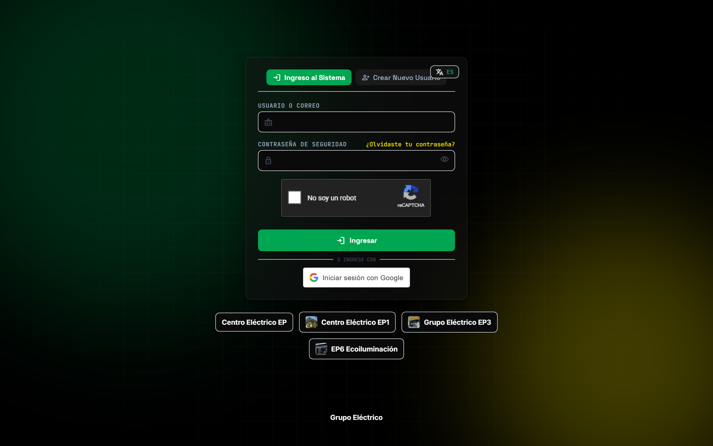

1. **Inicio de Sesión Seguro**: Ingresa tu **Usuario o Correo**, tu **Contraseña de Seguridad**, resuelve el **Captcha matemático** y presiona **Ingresar**.
2. **Aislamiento de Sesión por Pestaña**: Cada pestaña del navegador es independiente. Si abres otra pestaña nueva, el sistema te pedirá iniciar sesión nuevamente para evitar accesos no autorizados en equipos compartidos.
3. **Atajo Rápido al Panel Principal**: Desde cualquier parte del sistema puedes volver en un instante a la pantalla principal haciendo clic en:
   * El logo superior izquierdo **`GRUPO ELÉCTRICO`**
   * El texto **`PANEL PRINCIPAL`** en la barra lateral izquierda
   * El botón **`Panel Operativo`** en la barra lateral izquierda

---

## 👑 1. Manual del Administrador Global (`@tomas_admin`)

### 1.1 Galería Principal de Categorías con Fotografías
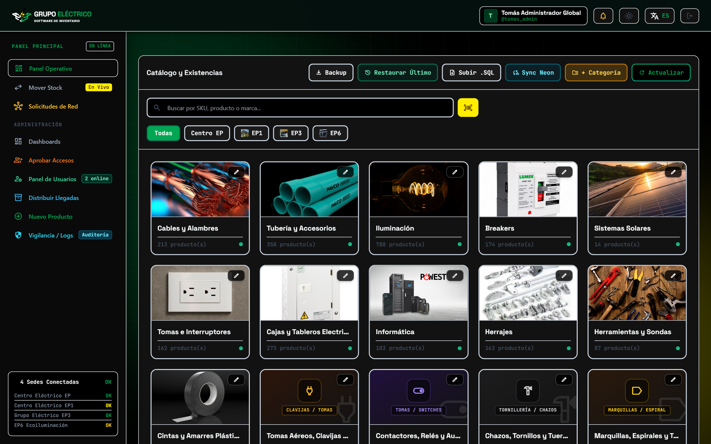

* Visualiza las **19 categorías del catálogo** con sus imágenes de presentación y el número de productos en cada una.
* **Editar Nombre o Imagen de Categoría**: Haz clic en el botón del **lápiz (`✏️`)** en la esquina superior derecha de cualquier categoría (incluyendo **`Sin Categoría`**) para cambiarle el nombre o subir una nueva fotografía desde tu computador.
* **Eliminar Categoría con Seguridad**: Dentro del modal de edición de categoría, el botón rojo **`Eliminar Categoría`** te preguntará: *`¿Seguro que quieres eliminar la categoría "(Nombre)"?`*. Si aceptas, los productos que estaban allí se moverán automáticamente a **`Sin Categoría`**.

### 1.2 Modo Búsqueda Dentro de Categoría
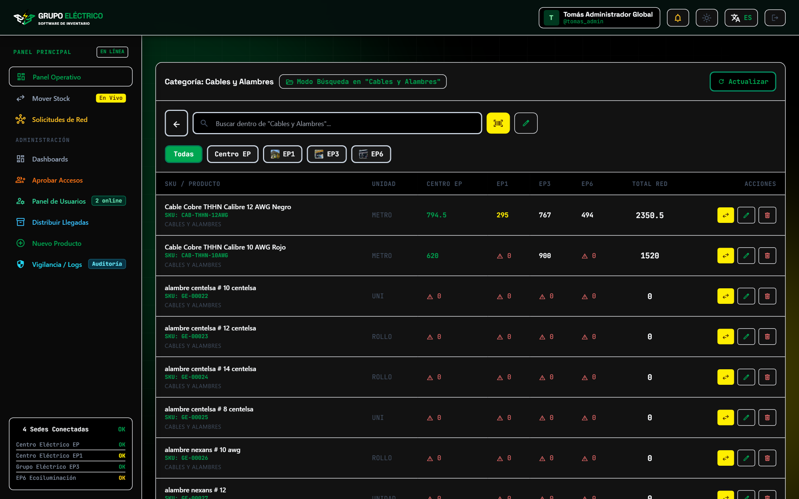

* Al entrar a cualquier categoría:
  * La pantalla sube automáticamente al inicio (`scrollTo(0, 0)`).
  * Se ocultan los botones superiores globales para mantener una interfaz limpia y enfocada.
  * El buscador filtra **exclusivamente dentro de la categoría seleccionada** (`Modo Búsqueda en "<Nombre de Categoría>"`).
  * La flecha **`←`** a la izquierda del buscador siempre está visible para volver a las categorías sin necesidad de borrar lo escrito.

### 1.3 Edición de Producto (`[✏️ Categoría / Editar]`) y Disponibilidad por Sede (`No maneja`)
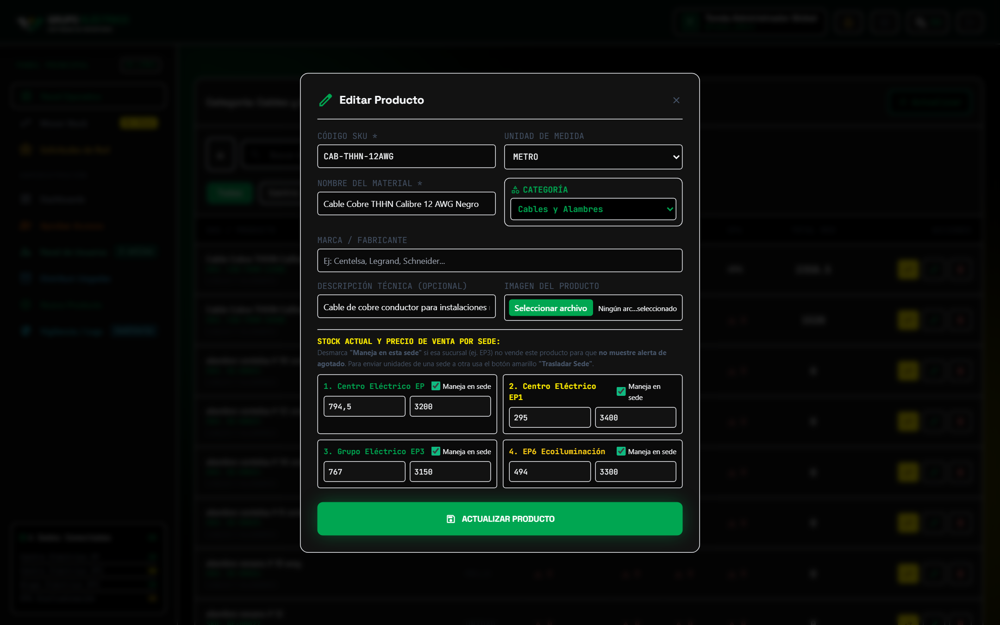

* Con el botón verde **`[✏️ Categoría / Editar]`** puedes cambiar el producto de categoría, actualizar precios o stock mínimo por sede.
* **Switch `"Se maneja en esta sede"`**: Si una sede (ej. EP3) no comercializa cierto producto (como herrajes especiales o accesorios de transformadores que solo maneja EP1), desmarca **`Se maneja en esta sede`** en esa sucursal. El sistema mostrará **`No maneja`** y desactivará las alertas de stock agotado para ese producto en esa sede.

### 1.4 Traslados entre Sedes (`[⇄ Sede / Mover Stock]`) con Corredor Opcional
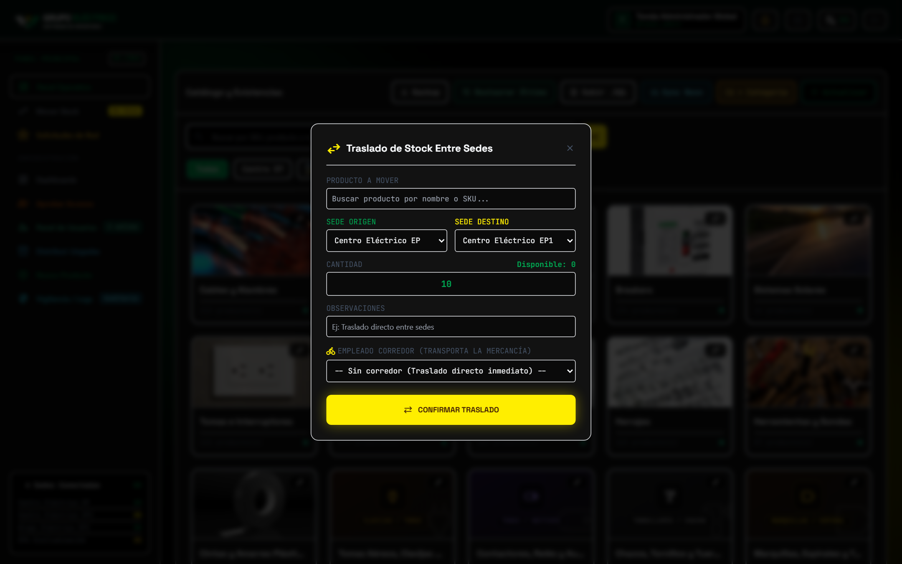

* Usa el botón amarillo **`[⇄ Sede]`** en la fila del producto o **`Mover Stock`** en la barra izquierda.
* El campo **`Corredor / Mensajero (Opcional)`** no es obligatorio: puedes dejarlo en **`-- Sin corredor asignado (Traslado directo / Ya surtido) --`** cuando envías el material directamente con personal a tu alcance o cuando ya fue surtido físicamente.

### 1.5 Dashboards en Tiempo Real, Historial Paginado y Optimización (+2 años)
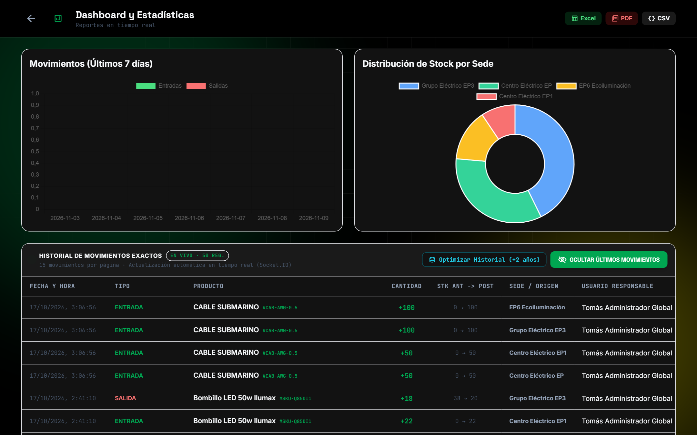

* **Botón `"Revisar Últimos Movimientos"`**: Abre bajo demanda el historial en vivo (actualizado por WebSockets en tiempo real), mostrando **15 movimientos por página** con controles de paginación (`1, 2, 3, Siguiente ›`).
* **Botón `"Optimizar Historial (+2 años)"`**: Archiva en almacenamiento histórico (*Cold Storage*) los movimientos con más de 24 meses de antigüedad y optimiza los índices de la base de datos para conservar máxima velocidad durante 10 a 20 años de operación continua.
* **Distribuir Llegadas (`+ Nueva Entrada`)**: En el menú izquierdo **`Distribuir Llegadas`**, encontrarás tanto la auditoría de recepciones de proveedores como el botón verde **`+ Nueva Entrada`** para ingresos directos.

---

## 🏪 2. Manual del Encargado de Sede (`ENCARGADO` — EP, EP1, EP3, EP6)

### 2.1 Galería de Categorías y Operaciones de Almacén Local
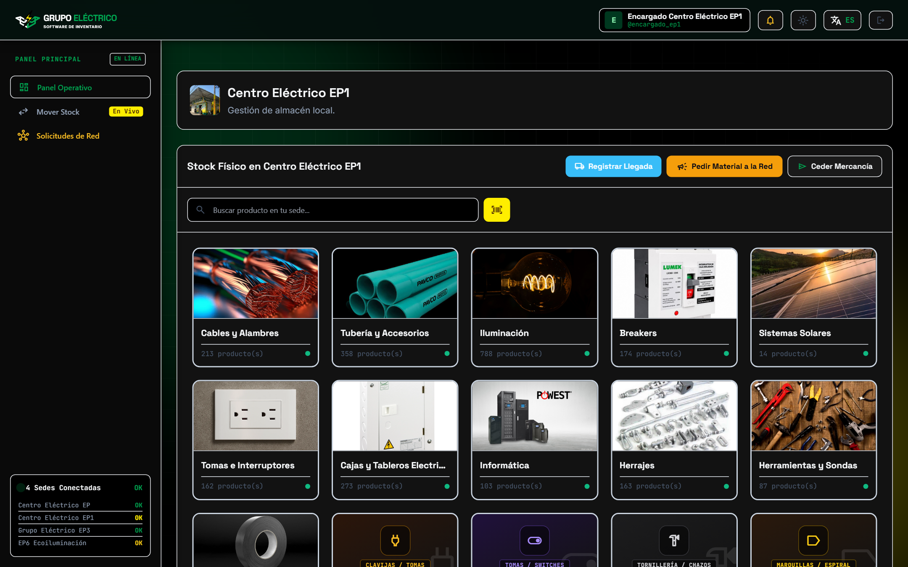

* El Encargado ve todas las fotografías de categorías subidas por el Administrador, con la misma fluidez de navegación pero **sin permisos para alterar ni eliminar categorías o productos del catálogo maestro**.
* Cuenta con 3 botones operativos principales para su sede:
  1. **`🚚 Registrar Llegada`**: Registra facturas/remisiones de proveedores que llegan a su sede y asigna el conteo físico a un empleado.
  2. **`📢 Pedir Material a la Red`**: Solicita mercancía urgente a las demás sedes con alerta sonora en tiempo real.
  3. **`📤 Ceder Mercancía`**: Despacha mercancía de su sede hacia otra sede.

### 2.2 Búsqueda por Categoría y Solicitud de Material a la Red
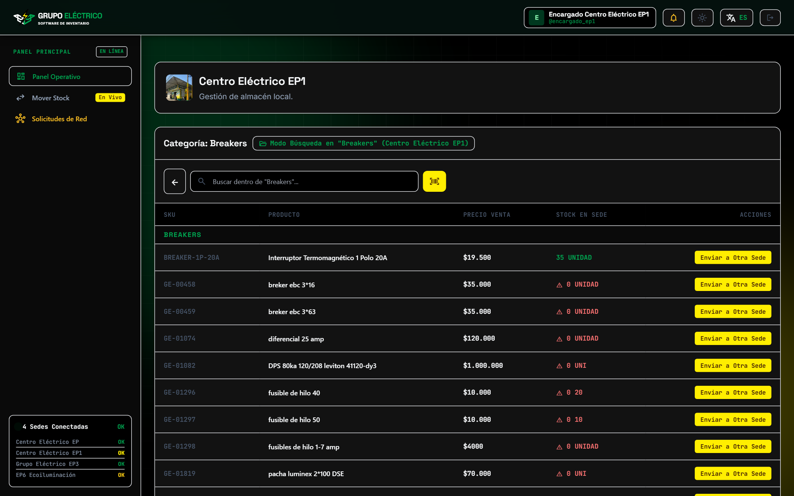
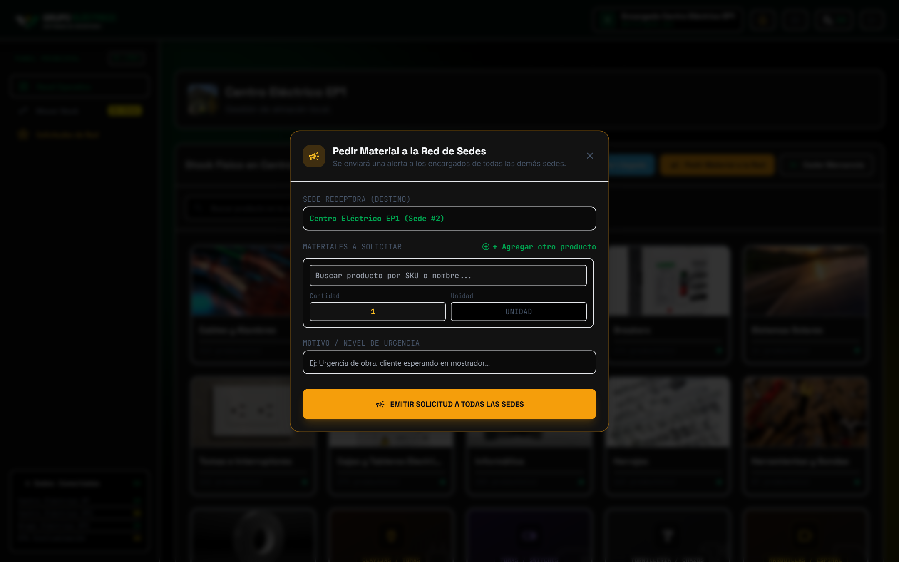

---

## 🛵 3. Manual del Empleado / Corredor Logístico (`EMPLEADO`)

### 3.1 Panel de 3 Columnas: Consulta Rápida, Entregas en Tránsito y Conteos
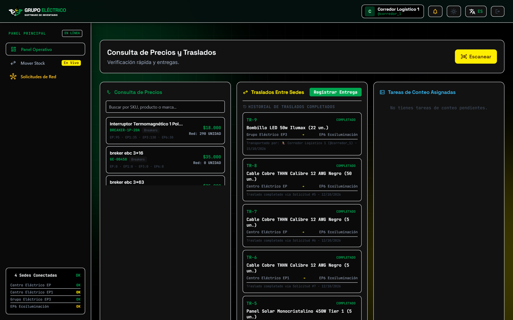

1. **Consulta de Precios y Stock por Sede**: Permite buscar por nombre, SKU o categoría y ver existencias en `EP · EP1 · EP3 · EP6`.
2. **Misiones Activas y Traslados**: Indica en qué sede recoger (**1. Recoger en**) y en qué sede entregar (**2. Entregar en**), con el botón verde **`Confirmar Entrega en Sede Destino`**.
3. **Tareas de Conteo Asignadas**: Permite reportar las cantidades recibidas en buen estado y defectuosas cuando llega mercancía de proveedores.

### 3.2 Escáner de Código de Barras (Cámara en Celular/PC o Lector USB)
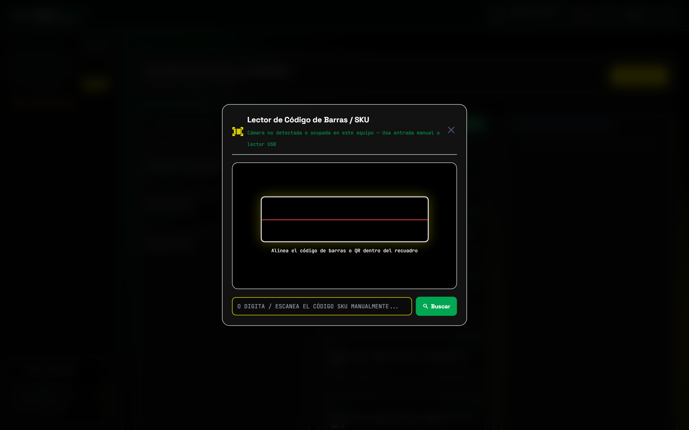

* Funciona con la **cámara de celulares, tablets o portátiles** (selector de cámara frontal/trasera incluido) y también cuenta con **entrada directa para pistolas láser USB o teclado**.

